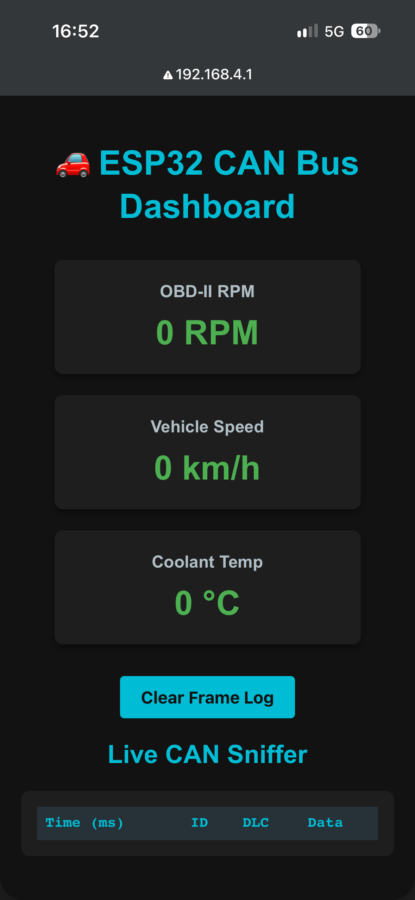

# ?? ESP32 CAN Bus & OBD-II Analyzer

An advanced, modular **CAN Bus** analyzer and **OBD-II** diagnostic scanner based on the **ESP32 (NodeMCU 38-pin / ESP-WROOM-32)** microcontroller and the **SN65HVD230 (VP230)** transceiver. The project features a real-time **Web Dashboard** accessible via Wi-Fi (Access Point) using WebSockets.

---

## ?? Web Dashboard Preview

  

---

## ?? Safety Disclaimer

> **WARNING:** Interacting with vehicle electronic systems (CAN Bus) involves the risk of disrupting ECU operations.
> * It is recommended to start in **Sniffer (Listen-Only)** mode, which is 100% passive and safe.
> * The author assumes no responsibility for any vehicle damage, check engine lights, or material losses resulting from improper connection or usage of this equipment.

---

## ?? Pinout / Wiring

### 1. ESP32 NodeMCU (38-pin) <--> SN65HVD230 (VP230) Module
> ? **IMPORTANT:** The SN65HVD230 module must be powered by **3.3V** only.

| VP230 Module | ESP32 NodeMCU (38-pin) | Description |
| :--- | :--- | :--- |
| **VCC / 3V3** | **3V3** | 3.3V Power |
| **GND** | **GND** | Common Ground |
| **CTX (TX)** | **GPIO 5** | CAN Transmit (TX) |
| **CRX (RX)** | **GPIO 4** | CAN Receive (RX) |

### 2. VP230 Module <--> Vehicle OBD-II Port
| VP230 Module | OBD-II Port | Description |
| :--- | :--- | :--- |
| **CANH** | **Pin 6** | CAN High |
| **CANL** | **Pin 14** | CAN Low |
| **GND** *(Recommended)* | **Pin 4 / 5** | Vehicle Ground |

---

## ?? Quick Start

1. Open the project in **VS Code** with the **PlatformIO** extension installed.
2. Connect the ESP32 to your computer via USB.
3. Click **Build** and **Upload** in PlatformIO.
4. Once running in the vehicle, connect to the Wi-Fi network:
   * **SSID:** `ESP32-CAN-Analyzer`
5. Open your browser and navigate to: **`http://192.168.4.1`**

For detailed installation steps and troubleshooting, check the [INSTALLATION_GUIDE.md](INSTALLATION_GUIDE.md).

---

## ?? License
This project is licensed under the **MIT** License - see the [LICENSE](LICENSE) file for details.
